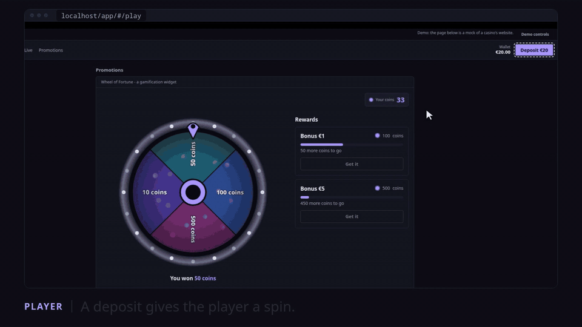

# Gamification service for casino operators: a working slice



*Real footage of the running system, 25 seconds: the player page, a casino whose answer is lost, the back office.*

## TL;DR

- **What it is.** A casino reports a player's deposit → the player spins a Wheel of Fortune → wins
  coins → spends them in a bonus store → we ask the casino to issue the bonus → the final status is
  in the API. Two simulated casinos with different APIs go through one internal logic.
- **The coins are not in PostgreSQL.** The ledger is TigerBeetle, a double-entry accounting
  database. A redemption is a two-step transfer: coins are reserved, then posted when the casino
  issues the bonus or voided when it refuses. The ledger itself refuses a negative balance.
- **It survives a casino that answers late, twice or never.** One model of a redemption for both
  platforms, one adapter per platform, and the rule "look first, then repeat". No bonus is issued
  twice and no coins are lost.
- **It is proven, not claimed.** A fake casino that loses answers, a judge that trusts only the
  casino's record and the ledger, random-fault tests, real processes killed mid-work, a measured
  load run. More than 350 automated tests; CI runs them and the compose stack.
- **It is operable.** Back office with sign-in and roles, full audit trail, alerts, stuck
  redemptions with manual resolution, replaceable signing keys, logs, traces, workers that scale
  by count.
- **How it was made.** One engineer in one working day. I made the decisions; AI agents wrote the
  code from written briefs; every decision and every AI mistake is in `docs/ai-log.md`.
- **What is not there.** Both casinos are simulated. No database-level tenant isolation, no
  secrets store, no migrations, no real integration.

Run it: `docker compose up -d --build --wait`, then open http://localhost:30080/app/ (details in
"Run it" below). A two-minute presentation: [`docs/video/presentation.mp4`](docs/video/presentation.mp4).

Where to look:

| What | Where |
|---|---|
| Architecture, with diagrams | `docs/architecture.md`, `docs/img/service.svg`, `docs/img/redemption.svg` |
| What happens on each failure, and the test that proves it | `docs/failure-table.md` |
| The contract the code was built from | `docs/contracts.md` |
| Sample requests and responses | `docs/samples.md` |
| How it is verified | `docs/verification.md` |
| Measured performance | `docs/performance.md` |
| Scaling questions | `docs/scaling-plan.md` |
| First 90 days | `docs/90-day-plan.md` |
| AI-development evidence: every decision, who made it, how it was checked | `docs/ai-log.md` |
| The briefs given to AI agents and their reports | `docs/agent-briefs/` |
| Rules the agents work under | `CLAUDE.md`, `.claude/skills/verify/SKILL.md` |
| A short presentation video | `docs/video/presentation.mp4` |

## The solution in five minutes

### 1. What the system promises

I started from what must never happen, not from features. Everything else in the project exists
to keep these promises when things fail.

1. One deposit gives no more spins than the grant policy of its time allows.
2. One spin gives one prize, and the server chooses it.
3. A coin balance never goes below zero.
4. One redemption never takes coins twice, and the casino never issues its bonus twice.
5. Coins are never taken without a bonus, and a bonus is never issued without the coins being
   taken, once everything has settled. Coins do not disappear while the casino has not answered.
6. One casino never sees or changes anything of another casino.
7. An event without a valid signature changes nothing.

For rules 3 to 6 there is a judge (`test/judge.ts`): it trusts only the casino's own record and the
ledger. It reads our redemption rows only to learn what we claim, and checks each claim against
those two. Rules 1, 2 and 7 are checked by ordinary tests of the intake and the wheel.

### 2. The coins are not in PostgreSQL

The coin ledger is **TigerBeetle**, a database built only for double-entry accounting. PostgreSQL
keeps everything else. This is the most unusual decision in the project.

**Why.** A ledger is a ledger: it is a solved problem, and solved very well. I would rather take
a finished one than reinvent it, all the more because this area is rich in traps and carries real
responsibility. Coins behave like money: they are won, reserved, spent, given back. A ledger written by
hand in SQL is where such products get their worst bugs (a balance column updated twice, a debit
without its credit, a race that goes below zero). TigerBeetle guarantees a correct ledger by
construction, has headroom far above this load, and removed most of the work of writing a ledger
by hand, so the day went into the product.

**The model maps onto it almost one to one** (`src/ledger/coin-ledger.tigerbeetle.ts`, port in
`src/domain/coin-ledger.ts`):

| In the product | In the ledger |
|---|---|
| A casino (tenant) | Its own `ledger` number. Accounts of two casinos can never be in one transfer. |
| A player's coins | One account with the flag "debits must not exceed credits". The ledger itself refuses a negative balance; our code cannot get it wrong. |
| A prize from the wheel | A transfer from the casino's issuer account to the player. |
| A redemption starts | A **pending** transfer from the player back to the issuer: the coins are reserved, not spent. |
| The casino issued the bonus | The pending transfer is **posted**. |
| The casino refused | The pending transfer is **voided**: the coins are back. |
| Coins owed to all players of a casino | The balance of ONE account, the issuer. Not a sum over players. |

**Two stores, no shared transaction.** The decision and a job are written to PostgreSQL in one
transaction. Then the job makes the ledger transfer. The transfer's id is derived from the id of
the decision (a hash of `xfer:prize:<spin id>`, `xfer:reserve:<redemption id>` and so on), so
running the job twice moves nothing the second time. If the process dies between the two stores,
the job is still in PostgreSQL and a worker repeats it.

**What it costs.** A second store to run and back up. No SQL: lists and reports read PostgreSQL,
the ledger is asked only for balances. In a container it needs io_uring, which Docker's default
security profile blocks (hence one extra line in `docker-compose.yml`). I set two conditions before using it: prove the official
image on other hardware in the first hour (done on a CI runner), and keep a fallback to a ledger
table in PostgreSQL (not needed).

### 3. The hard part

The casino is outside our control. It can answer late, twice, or never. And the two casinos have
different APIs. Platform A answers a reward request at once and accepts an idempotency key.
Platform B accepts the request, reports the result later by a webhook, and has no idempotency key.

### 4. Two decisions on top of the ledger

**One model for both platforms.** There are many casinos and one domain logic. A redemption is an
intent: created → reserved → submitting → issued or refused. The platform that answers at once is
the same model with two steps taken at once. There is one adapter per platform
(`src/integrations/`, interface in `src/domain/casino-platform.ts`) and one function that confirms
the outcome, whoever brings it: the platform's answer, its webhook, our own look-up, or an admin
(`confirm` in `src/store/redemption.ts`).

**Look first, then repeat.** After an unknown outcome we ask the casino whether the bonus exists
before we send the request again. On a platform without an idempotency key this is the only thing
that prevents a second bonus.

The other decisions, in one line each:

- **Workers scale by count.** A job is claimed with a lease in one short statement, the casino and
  ledger calls run with no database transaction open, and only the holder of the lease writes the
  outcome. The queue is a table in PostgreSQL on purpose: a job is written in the same transaction
  as the decision that needs it. Handlers do not know who calls them, so a broker can be put after
  the table later (`docs/scaling-plan.md`, answer 1).
- **The server picks the prize.** The outcome is computed from a secret of the tenant and our spin
  id; the wheel's configuration is versioned and pinned when the spin is granted. The page only
  shows the result.
- **Differences between operators are versioned settings, not code.** Grant rules, limits and the
  wheel are rows with versions. A casino's admin proposes a new wheel; a policy applies it at once
  if the expected prize is within the limit, otherwise it waits for us.
- **Everything that changes is audited** in the same transaction, with who did it and the request
  id. The audit table accepts no update or delete.
- **Operations:** a back office with sign-in and three roles, alerts as plain SQL, a list of stuck
  redemptions with a manual resolution that goes through the same confirm function, replaceable
  signing keys, structured logs, traces.

### 5. How I know it works

The casino is simulated, and the simulation can lose a request, lose its answer, answer slowly,
refuse, and send a result twice. The judge checks the promises against the casino's own record and
the ledger. On top of that there is a test that generates random faults
(`test/properties.test.ts`) and a test that starts real processes and kills a worker in the middle
of its work (`test/processes.test.ts`). That last one found a real defect: a process starting
under load could deadlock on the schema script. An independent review at the end of the day found
more defects on the intake and the wheel; they are in the log with their fixes.

I also measured instead of guessing (`docs/performance.md`). The first load run showed a design
mistake: the job queue made casino calls inside a database transaction. It was replaced with
leases. Redemption requests went from about 30 per second at any concurrency to over 100 at 64
concurrent requests, on a busy development machine, and the time workers need to finish a backlog
halves with two workers and again with four.

### 6. How it was made

I made the decisions; AI agents wrote the code from written briefs, each in its own branch. Every
piece had to come back with what can break, which test catches it, and what happened when the code
was broken on purpose. Every decision is in `docs/ai-log.md` with who made it and how it was
checked, including where the AI was wrong. More in "How this was made" below.

### 7. What is not there

Both casinos are simulated, and one of the simulation's assumptions is kind: that platform B's
look-up shows a request at once. Tenant isolation is enforced in code and by a test that walks
every route, with no second lock in the database. Secrets are plain text in the database. There
are no schema migrations yet. The prototype is wider than the task asked; the part I know best is
the path of a coin. The full list is in "What is real, what is simulated, what is not built".

## Run it

Needs Docker with Compose. This starts PostgreSQL, TigerBeetle, the API, two workers, the fake casino
and a trace viewer, then asks the API if it is healthy:

```
docker compose up -d --build --wait
curl http://127.0.0.1:30080/health
```

The answer is `{"ok":true,"postgres":"ok","ledger":"ok"}`.

Then open three pages in a browser:

- http://localhost:30080/app/ is the player page: a Wheel of Fortune you can spin, your coins and the
  reward store, as it would sit on a casino's site. "Deposit" at the top right stands for the casino
  telling us about a deposit. The link "See what happened behind the scenes" under the widget opens
  this player in the back office.
- http://localhost:30080/app/#/admin is the back office. It needs a sign-in. The sign-in page lists the
  demo users as buttons that fill the form. It reads everything from the server: overview, alerts,
  redemptions (with the manual resolution of a stuck one), players, events, spins, settings (a proposal
  for a new wheel, and replacing a casino's signing keys), waiting changes for the platform admin, outbox and audit. The player page
  and the back office are one app with two routes and share no state.
- http://localhost:30081/ is the casino control panel. It makes the casino misbehave (ten scenarios in plain
  words), shows what the casino really issued and checks that no bonus was issued twice and no coins were lost.

Demo users of the back office (the demo seed creates them; the sign-in page also lists them):

| Email | Password | Role | Tenant |
|---|---|---|---|
| `ops@demo.local` | `demo-ops-password-1` | platform admin | all, can approve waiting changes |
| `manager@alpha.demo` | `demo-alpha-manager-1` | tenant admin | alpha-casino |
| `viewer@alpha.demo` | `demo-alpha-viewer-1` | tenant viewer, read only | alpha-casino |
| `manager@beta.demo` | `demo-beta-manager-1` | tenant admin | beta-casino |

Five wrong passwords lock a user for 15 minutes. Sign in from the command line and use the token:

```
TOKEN=$(curl -s -X POST http://localhost:30080/admin/auth/login -H 'content-type: application/json' \
  -d '{"email":"ops@demo.local","password":"demo-ops-password-1"}' \
  | python3 -c 'import sys, json; print(json.load(sys.stdin)["token"])')
curl -s http://localhost:30080/admin/alpha-casino/overview -H "authorization: Bearer $TOKEN"
```

The sign-in answers `{ token, expiresAt, user }`; the token lasts 30 minutes.

Sample requests are in `docs/samples.md`.

Traces: open http://localhost:30086 (Jaeger), pick the service `gamification` and press "Find Traces".
Each request is one trace; the response header `x-trace-id` is its id. A redemption on platform A shows
`ledger reserve`, `platform find A`, `platform issue A` and `ledger capture` under one
`http POST /store/redemptions` span, with every database call and its time. Platform B's later steps are
traces of their own named `outbox redemption_advance`. Jaeger keeps at most 10000 traces in memory.
Set `OTEL_TRACES_SAMPLE_RATIO` (0 to 1) to trace only a share of requests, for a load run. Details are in
the "Tracing" section of `docs/contracts.md`.

To look at the screens without the stack: `npm run web:build`, then `node web/dev/mock-server.mjs` and open
http://localhost:4800/app/. The mock is a development aid built from `docs/contracts.md`, not the service.

If a port is taken on your machine, set another one: `APP_PORT` (30080), `FAKE_PORT` (30081),
`JAEGER_PORT` (30086), `TB_PORT` (30009), `PG_PORT` (54329), for example
`APP_PORT=8080 docker compose up -d --build --wait`.

More workers: `docker compose up -d --scale worker=4`. Workers are the same image started with
`ROLE=worker`; they take jobs from the outbox and can be added or removed at any time.

Stop and delete the data:

```
docker compose down -v
```

Run the checks (typecheck, lint, tests). Needs Node.js 22. The tests start their own PostgreSQL
in Docker and use the TigerBeetle from Compose:

```
npm ci
docker compose down
docker compose up -d --wait tigerbeetle
TB_ADDRESS=127.0.0.1:30009 npm run verify
```

Stop the rest of the stack first, as above: the tests start their own API and worker processes
against the same TigerBeetle, and several of them have time limits that a busy machine can miss.
In a clean-clone check, a run beside the full stack on a loaded machine failed with timeouts, and
the same command passed once the stack was stopped.

The web app (`web/`) is built in the app image. To check it on its own: `npm run verify:web`
(installs, type-checks, runs its unit tests and builds).

These commands are the ones CI runs on every push (`.github/workflows/ci.yml`), on a GitHub
runner with the official images.

TigerBeetle needs Docker to allow io_uring (hence `seccomp=unconfined` in `docker-compose.yml`).
Its official builds use AVX2, which server CPUs and any desktop CPU of the last ten years have.
The project was developed on an older desktop CPU without it; `scripts/tb-old-cpu.sh` is the
workaround for such a machine and is not needed anywhere else.

## Design

See `docs/architecture.md`.

## What is real, what is simulated, what is not built

**Real:** the application (NestJS, TypeScript), PostgreSQL 16, TigerBeetle 0.17.9 with its official
client, Docker Compose, CI on GitHub Actions; signatures, player tokens, deduplication, the redemption
state machine, the outbox with leases, the audit trail, alerts, logs, traces, the back office and the
player page. The tests run over real HTTP, a real PostgreSQL and a real TigerBeetle.

**Simulated:** both casino platforms (`src/fake-casino/`, one process, state in memory). The
simulation is kinder than a real platform in these ways:

- Platform B's look-up shows a request as soon as the request was accepted. If a real platform lags,
  "look first" sees nothing and we would issue a second bonus. Our side cannot close this alone; it
  has to be agreed with the platform. This is the weakest assumption in the project.
- Platform A keeps the first answer for an idempotency key for as long as its process runs.
- Both platforms can find a reward by our reference.
- Amounts have two minor digits in every currency.
- The player id in events and in the player token is the same stable id.
- A platform never changes a final answer. If it does, we record the contradiction and raise an
  alert; we do not move coins on our own.
- A deposit is never reversed.

**Not built:** a real casino platform; missions and other mechanics; a queue in front of the event
intake; the real-time gateway; coin expiry; revoking a reward; deposit reversals; delivery of alerts
to people; the run of the daily digest agent (its playbook is written: `docs/monitoring-playbook.md`);
rate limiting; a secrets store (secrets are plain text in the database); schema migrations (the
schema is applied as one idempotent file); password reset and token refresh for admins; replacing the
wheel secret and the platform API key; a second lock for tenant isolation inside the database.

**Where it runs:** CI runs the tests and starts the whole compose stack on a GitHub-hosted Linux
runner with the official images on every push. (Several runs today were red because of one test
with a wall-clock limit; the log has the story.)
Not proven: Docker Desktop on macOS or Windows, and hosts where io_uring is disabled. TigerBeetle
needs io_uring, which Docker's default security profile blocks, hence `seccomp=unconfined` in
`docker-compose.yml`.

## Priorities: what I chose to do in the time, and why

1. **The first hour had no code.** I restated the task, wrote the list of what must never happen
   and made the product decisions one at a time. That list became the judge.
2. **The reward request first, and correctly.** Duplicates, lost answers, timeouts, refusals,
   crashes between the two stores. This is where a product like this loses money, so it got the
   most tests.
3. **Then operations:** audit from the start, a back office that can see and resolve a stuck
   redemption, alerts, logs, traces. A system that issues value has to be explainable afterwards.
4. **Then measurement.** The first load run found a design mistake of mine: the outbox ran casino
   and ledger calls inside a database transaction. It was replaced with leases and measured again
   (`docs/performance.md`).
5. **What I left out on purpose:** more mechanics, a real integration, database-level isolation.
   They are in the plan, not half-built.

The prototype is wider than the task asked. The core (points 1 and 2) is the part I would defend
line by line; the rest shows the direction.

## Assumptions I made where the task did not say

- The wheel is our widget on the casino's site. The player's browser talks to us with a short-lived
  token signed by the casino; we never see a password.
- One successful deposit gives one spin by default. The rule is a versioned setting per casino
  (minimum amount, currencies, spins per deposit).
- A deposit event is trusted only by its signature. Each platform signs in its own way.
- A spin's prize is fixed by the server at the moment of the spin; the wheel's configuration is the
  one in force when the spin was granted.
- A redemption that the casino has neither issued nor refused stays open and visible. We do not
  time it out into a refusal on our own: whether to refund or keep waiting is an agreement between
  our business and the casino. After a limit from the settings it raises an alert, and an admin
  can resolve it by hand, with an audit record.
- Automatic recovery uses the platform's status look-up, so it works only where the platform has one.
- Personal data: we keep the casino's player id and nothing else about the person.
- The simulated platforms' assumptions are listed in the section above.

## How it is verified

The approach is in `docs/verification.md`; the short version:

- **A fake outside world with faults.** The fake casino can answer with an error, rate-limit, refuse,
  lose the request, lose its answer, answer slowly, and for platform B lose, repeat or delay the
  result message.
- **A judge** that trusts only the casino's record and the ledger, for the rules about coins and
  rewards (3 to 6).
- **Flow tests** from the first request to the judge's verdict, one per failure that matters. Each
  row of `docs/failure-table.md` names its test, or says "not tested".
- **A clock the tests move.** Tests do not sleep, except the few that check that calls overlap in
  real time.
- **Breaking the code on purpose.** Every piece of work had to show a test failing when a guard was
  removed. Results are in `docs/ai-log.md` and the agents' reports.
- **A measurement, not a quoted number.** `docs/performance.md` has the runs, the conditions and
  what was not measured.

Known weak points of the verification: everything outside is simulated; one test of the back
office overview compares counts while jobs may still be running and has failed under heavy load on
the development machine; the screens were checked in a real browser by hand and by scripts, not by
an automated browser suite.

## Likely changes, and where they go

| Change | Where |
|---|---|
| A third casino platform | a new adapter in `src/integrations/` implementing `CasinoPlatform` (`src/domain/casino-platform.ts`), registered in `src/integrations/platforms.ts`; the platform name is also listed in `src/tenants/tenants.ts` and in a `CHECK` on `tenants.platform` in `src/schema.sql` (an existing database keeps the old `CHECK`: there are no migrations); a twin in `src/fake-casino/` |
| A different rule for granting spins | `src/policies/grant-policy.ts` (`spinsForDeposit`) and the fields of a grant policy version |
| Wheel segments, weights, store items of the demo | `src/tenants/demo-tenants.ts` |
| How the prize is picked | `src/wheel/pick-segment.ts` |
| A new step or outcome of a redemption | `src/store/redemption.ts` (`step`, `confirm`) |
| A new kind of event from a casino | the platform's adapter (`parseEvents`) and `src/events/` |
| A new alert | `src/alerts/alerts.ts` |
| Who may do what in the back office | `src/admin/permissions.ts` (`can`) |
| A new table or column | `src/schema.sql`; writes go through `src/audit/audited.ts` |
| A new back office page | `web/src/sections/` |

Any new HTTP route must also be placed in the tenant isolation test (`test/tenant-isolation.test.ts`),
which fails until a decision is made for it.

## How this was made

I worked with AI agents the whole day and did not read the code line by line. My part was the
decisions, the direction and the checks; this is how it went:

- **I made the product and architecture decisions**, one question at a time, before any code. They
  are marked "Author" in `docs/ai-log.md`: the ledger in TigerBeetle, ports and adapters, the
  redemption as an intent with one confirm function, reserve instead of debit, audit from the start,
  settings changes as an intent with a policy, alerts as deterministic SQL, manual resolution with
  audit, real sign-in for the back office, workers that scale, key replacement, the shape of the
  tenant isolation test.
- **A main session wrote the contract** (`docs/contracts.md`, the schema, the domain interfaces) from
  those decisions. **Coding agents built from written briefs**, each in its own branch with its own
  list of files, and had to report: what was built, what can break, which test catches it, and what
  happened when they broke the code on purpose. The briefs and reports are in `docs/agent-briefs/`.
- **After each piece I got a short summary** in place of a code review: what it does, what can
  break, which test shows it. When I asked "what happens if", the answer had to come from a run.
- **How the AI's output was checked:** `npm run verify` before every commit; the judge; mutation
  checks; CI on other hardware; a load measurement; my own look at the pages.
- **Where the AI was wrong and how it was found:** the log keeps these. Examples: an outbox that
  held a transaction across network calls (found by measurement); a back office first protected by
  shared key headers (I rejected it); two ledger accounts per tenant where one gives the total owed
  as a single balance (found in review); a first demo page nobody could understand (I rejected it);
  a test that demanded more than the system promises (found by CI); drifting away from the
  verification approach in the afternoon (I noticed, and two missing kinds of test were added).

