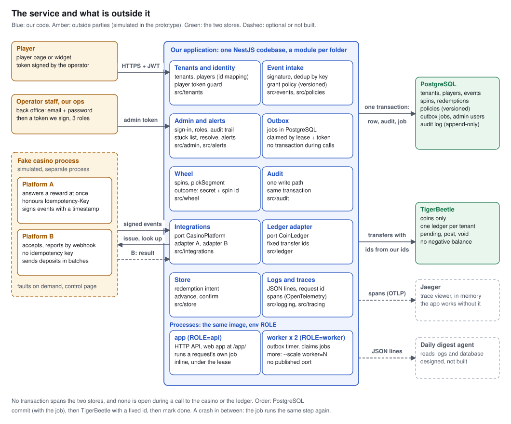
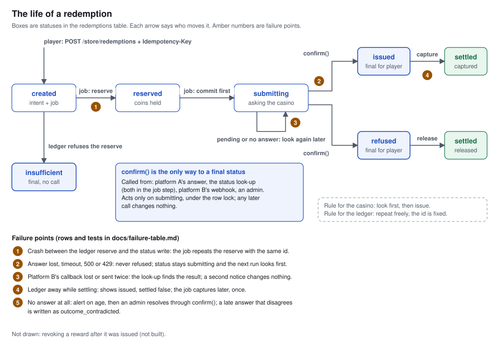

# Architecture

A casino platform tells us that a player made a deposit. The player gets a spin of a Wheel of
Fortune. The prize is coins in a ledger. The player spends coins in a bonus store, and we ask the
casino platform to issue the reward. Two simulated platforms with different APIs stand in for real
casinos.

What the system promises is a list of things that must never happen (`docs/contracts.md`, checked
by `test/judge.ts` against the fake casino and the ledger, not against our own tables). One deposit
never gives more spins than the grant policy of its time allows. One spin never gives more than one
prize, and the client never chooses the prize. A coin balance never goes below zero. One redemption
never reserves or takes coins twice, and the casino never issues its reward twice for it. Once
everything has settled, coins are never taken without a reward, and a reward is never issued without
taking the coins. One tenant never sees or changes anything of another tenant. An event without a
valid signature never changes anything.

In this document "I" is the author. The source of every decision is `docs/ai-log.md`; where the
agent proposed something and I accepted it, the text says so.

## The service

- Amber is outside: the player, operator staff, and the casino platforms. In the prototype the two
  platforms are one fake casino process with faults on demand.
- Blue is our application: one NestJS codebase, one module per folder in `src/`. The same image runs
  as two kinds of process, chosen by the env `ROLE`: `api` answers HTTP, `worker` runs the outbox
  jobs. Compose starts one `app` (api) and two `worker` processes; `docker compose up --scale
  worker=N` starts more. `ROLE=all` (the default) does both in one process.
- Green is the two stores: PostgreSQL holds state, events, jobs, admin users and the audit log;
  TigerBeetle holds only coins.
- Nothing outside `src/integrations` knows a platform's field names.
- No transaction spans the two stores, and no transaction is open while we call the casino or the
  ledger. The outbox repairs a crash between the two stores.
- The web app (`web/`, React) is served by the api process at `/app/`. It has a player page and a
  back office, and it calls the same public API as any client. The player page's "behind the
  scenes" link opens that player's page in the back office.
- Jaeger (a trace viewer, port 30086) receives traces; the app works the same without it.
- The daily digest agent is designed, not built.

## The nine parts, one by one

### Multi-tenant SaaS with tenant isolation

Today: every table carries `tenant_id` and every query filters by it (`src/schema.sql`). The tenant
of a request comes from a place the caller cannot forge: the path plus the tenant's own webhook
signature, the player token's signature, or the signed admin token (its `tid` claim, checked
against the path). Each tenant has its own TigerBeetle ledger (`tenants.ledger_no`), and
TigerBeetle never moves coins between two ledgers.

Decisions: a ledger per tenant comes from the build contract, which the agent wrote from my
decisions (log, 11:46). Isolation is enforced in code and checked by tests. I first put isolation
enforced by the database at the top of the work for production (log, 13:08), and later changed my
mind. My position now: a test that reads every route of the application and forces a decision for
each one (two lists, checked and skipped; a route in neither list fails the test), kept mandatory in
CI. I prefer this to row-level rules in the database. Database rules, or a separate database per
casino, come only when a client's contract requires them. That route test is `test/tenant-isolation.test.ts`. See "Security" for the other tests and the
limit.

### Casino integration layer supporting different external APIs

Today: ports and adapters. The domain declares the port `CasinoPlatform`
(`src/domain/casino-platform.ts`): `parseEvents`, `parseRewardNotice`, `issueReward`, `findReward`.
`src/integrations/platform-a.ts` and `platform-b.ts` translate each platform into it, and
`PlatformRegistry` picks the adapter by `tenants.platform`. One call function,
`src/integrations/http.ts`, puts a time limit on every outgoing call and cancels it with
`AbortController`. Any answer the contract does not list becomes `PlatformUnreachable`, never
"refused".

The two platforms differ in behaviour, not only in field names. Platform A answers a reward request
at once and honours an idempotency key. Platform B accepts, reports the result later by webhook, and
has no idempotency key.

Decisions: ports and adapters, with the domain in the middle and one adapter per casino platform,
is my choice (log, 11:39). In my words: there are many casinos and one domain logic, classic OOP.
Two casinos on the same platform share one adapter with different settings. The agent asked to keep
one file per entity so a live change stays easy. The domain speaks of three outcomes of a reward
request: `issued`, `refused`, and `pending` (not final, or we do not know yet) (`RewardOutcome`, my
decision, 11:39). The status the player sees is built from the same words. Whether a platform can
be asked for the status of a reward is a property of its adapter (my decision, 12:11). Not built: a
real platform.

### Player identity mapping

Today: `players` maps the platform's player id (`external_id`) to our id, unique per tenant
(`src/tenants/players.ts`, `findOrCreatePlayer`, safe when two first requests race). The player calls
us with a short-lived HS256 token that the operator signs with the tenant's player token secret
(`src/tenants/player-token.ts`): `iss` is the tenant, `sub` is the platform's player id, `exp` is
required and at most 15 minutes ahead. `PlayerAuthGuard` takes tenant and player from the token only,
never from the path or the body. Every failure is the same 401.

Decision: mine, after a discussion (log, 11:33). I doubted that players should call us directly and
treated it as a business question. The agent argued that a widget we own is what lets new mechanics
ship without work on each operator's side. The assumption: the wheel is our widget on the casino's
page, and the same API works if the operator calls it from its own server. Not built: asymmetric
tokens (the operator holds a private key, we hold only the public one), revocation of one token.

### Event ingestion, validation, deduplication and processing

Today: `POST /webhooks/:tenantId/events` (`src/events/events.controller.ts`). The tenant's adapter
checks the signature over the raw bytes (platform A also rejects a timestamp more than 5 minutes
away) and translates the event into `DepositSucceeded` or `IgnoredEvent`. A bad signature is 401 and
one audit record `webhook_rejected`; a signed but bad body is 400 and `webhook_invalid`. Each event
then runs in its own transaction (`src/events/deposit.ts`, `ingestEvent`). The event is stored first,
with its normalised and raw form; the unique key `(tenant_id, external_event_id)` is the
deduplication, so a repeat inserts nothing and grants nothing. For a deposit, the newest grant
policy decides how many spins to create, in the same transaction; `UNIQUE (source_event_id, ordinal)`
is a second guard.

Tenant keys: a tenant's admin can replace the event signing secret and the player token secret from
the back office. The old secret keeps working until a time the admin chooses (0 to 24 hours) and can
be stopped early. The new secret is shown once. Every replacement is an audited change of the tenant
row. One function, `activeSecrets` (`src/tenants/active-secrets.ts`), decides which secrets are
valid now, for both adapters and the player token check (`docs/contracts.md`, "Tenant keys").

Decisions: a duplicate event is a log line (`event.duplicate`), not an audit row. In my words: a
repeated event changes nothing, so it is not an audit entry; the audit trail records changes (log,
12:52). The digest agent reads the share of duplicates from the logs. Ingestion is synchronous in the
prototype: the webhook answers after the commit. Not built: a queue in front of the intake (see
"Modules and services"), reversal events (a deposit taken back), events other than deposits.

### Gamification rules engine

Today there are two decision points, both pure functions with versioned parameters.

- `spinsForDeposit(deposit, params)` in `src/policies/grant-policy.ts`: minimum amount, allowed
  currencies, spins per deposit (0 to 10, enforced by `validateGrantParams`). Zero spins writes the
  audit record `spin_not_granted` with the reason. Each spin stores the `grant_policy_id` it was
  granted under.
- `pickSegment(wheelSecret, spinId, segments)` in `src/wheel/pick-segment.ts`: the first 8 bytes of
  HMAC-SHA256 of our own spin id under the tenant's secret, modulo the sum of the weights. Each spin
  stores the `wheel_config_id` that was current when it was granted.

Decisions: the outcome is computed, not drawn (mine, from two options the agent gave, log 11:30). A
repeated request gives the same outcome, and an auditor can compute it again. Differences between
operators are policies: named decision points whose parameters are versioned settings of the tenant,
not code (mine, 11:53). A new condition must be cheap to add: one field, one check, one test row
(mine, 12:00; the agent chose the shape, 12:13). Not built: conditions that need history (spins per
player per day), missions, other mechanics.

### Virtual currency ledger

Today: the port `CoinLedger` (`src/domain/coin-ledger.ts`), implemented on TigerBeetle 0.17.9 in
`src/ledger/coin-ledger.tigerbeetle.ts`. Double entry, one TigerBeetle ledger per tenant. Per tenant:
one `issuer` account. Per player: one account with the flag
`debits_must_not_exceed_credits`, so the ledger itself refuses a negative balance, also under
concurrent requests. Every account and transfer id is the first 16 bytes of SHA-256 of a string built
from our own ids (`xfer:prize:<spinId>`, `xfer:reserve:<redemptionId>`, and so on), so a repeated
call moves nothing. A prize is a posted transfer from issuer to player. A redemption reserves coins as
a pending transfer from player back to `issuer`; capture posts it, release voids it. The coins all
players of a tenant still hold are the balance of one account, not a sum over players: what left
`issuer` minus what came back to it (`outstanding`). Every call has a time limit (`LEDGER_TIMEOUT_MS`)
and throws `LedgerUnavailable` after it; the client call is not cancelled, which is safe because
the retry uses the same id.

Decisions: double entry in TigerBeetle is mine (log, 11:00), on two conditions: prove the official
image on other hardware in the first hour, and fall back to a transfers table in PostgreSQL if the
integration was not done by 14:00. My reasons for TigerBeetle: it guarantees that the ledger is
correct, it has headroom far above this load, and it removes most of the work of writing a ledger
by hand, which frees time for the product. Pending, post and void for a redemption is mine, from two
options (11:30). My reason: coins are reserved, not spent, until the casino answers, so coins never
disappear while the casino has not answered. The id scheme and the account layout came with the
build contract the agent wrote. Not built: expiry of coins, a reward revoked after it was issued.

### Reward redemption and delivery

Today: `src/store/redemption.ts`. One internal model for both platforms: a redemption is an intent
that is created and then confirmed (my model, 11:39; the agent pointed out that the two platforms
behave differently). The synchronous platform A is the same model with the two steps taken at once.
`POST /store/redemptions` with an `Idempotency-Key` creates the row (`created`) and its outbox job in
one transaction; a repeated key returns the first row and changes nothing. `advance` does one step
per call and is safe to repeat: `created -> reserved` (ledger reserve) or `insufficient`;
`reserved -> submitting`, committed before any call to the platform; in `submitting`, look first
with `findReward` and call `issueReward` only when the platform has never heard of the request;
`issued` or `refused`, then capture or release, then `settled_at`.

Two opposite rules, stated at the top of the file. A call that issues a reward may be repeated only
after looking, because platform B has no idempotency key and a blind repeat would grant twice. The
look-first rule is part of my decision of 11:30. A ledger step may be repeated freely, because its
transfer id is fixed by the redemption id (from the build contract).

`confirm(redemptionId, outcome)` is the only function that makes a redemption final. It acts only
when the status is `submitting`, under the redemption row lock in one short transaction; every later
call changes nothing. It is reached from four places: platform A's answer and the status look-up
(both inside the job step), platform B's webhook (`applyNotice`), and an admin
(`src/admin/resolve.ts`). An unknown outcome (timeout, 5xx, 429) is never "refused"; the redemption
stays `submitting`, which the player and the operator can see.

Two stores without a shared transaction: the order is always PostgreSQL first (the decision and the
job, one transaction), then TigerBeetle with the fixed id, then mark the step done. A crash in between
leaves the job due, and the job runs the same step again.

The outbox (`src/outbox/outbox.ts`) runs the jobs. A worker claims due jobs with a lease: one short
statement (`FOR UPDATE SKIP LOCKED` inside it) sets `claimed_until` and a fresh `claim_token`, and
commits at once. The handlers, which call the casino and the ledger, then run with no transaction
open and no connection held. The outcome is written only with `WHERE claim_token = <ours>`; a
worker whose lease ran out writes nothing and logs `outbox.lease_lost`. A worker that dies leaves its
claim, and after `claimed_until` another worker runs the job. The request that created a redemption
claims its own job the same way (`claimOne`) and runs up to five steps at once (`runInline`); if a
worker holds the job, the request returns the current state without waiting. The timer of a worker
looks for due jobs every 500 ms.

An earlier version ran each handler inside a transaction while holding the job's row lock, and a
redemption request did the same under a limit of two at a time. That was a design mistake: a slow
casino answer kept a database connection and a transaction busy. The load measurement found it, and
it was changed to the lease described above (`docs/performance.md`, "Change made after this
measurement").

That PostgreSQL holds the queue of outgoing calls is my decision (11:00); the order of writes is in
the contract the agent wrote.

### Admin configuration

Today: settings are rows, never edited. `wheel_configs`, `grant_policies` and `ops_policies` are
versioned per tenant; a change is a new row with the next version, and a trigger forbids UPDATE and
DELETE. The newest version applies to new work. A spin keeps the wheel and the policy it was granted
under. The admin API (`src/admin/`) has the read endpoints of the back office, the audit trail, the
list of stuck redemptions, manual resolution, the alerts, the change of the wheel and the tenant
keys. It needs a sign-in: `POST /admin/auth/login` checks an scrypt password hash in `admin_users`
and answers a token we sign (HS256, 30 minutes). Three roles (`tenant_viewer`, `tenant_admin`,
`platform_admin`) are decided in one function, `can`. Five wrong passwords in a row lock a user for
15 minutes. The actor in the audit trail is `admin/<user id>`, and the back office shows the user's
email next to it. There are no shared admin keys.

Decisions, mine (log, 12:00 and 12:01): a change of settings is an intent, like a redemption. The
casino's representative creates it; a policy decides whether it is applied at once or waits for us;
which policies apply to which casino only we decide. For a wheel change the policy looks at the
expected prize of one spin: within the limit we set for that casino it is applied automatically,
above it the change waits for a platform admin. Built: the intent for the wheel (`POST
/admin/:tenantId/settings/wheel`, approval by the platform admin) and the back office screen. Not
built: the same for grant and ops policy versions; tests and the seed insert those through the
audited `create`.

### Observability, auditability and security

Audit: `src/audit/audited.ts` is the only write path for `players`, `inbound_events`, `spins`,
`redemptions`, `store_items`, the three policy tables and `tenants`. `create`, `update` and `remove`
write the audit row in the caller's transaction, one entry per changed field; `record` writes a fact
that is not a row change (`platform_call`, `webhook_rejected`, `manual_resolution`,
`outcome_contradicted`). `update` locks the row and runs the state check under the lock, so it is also
the guard against two callers racing. Tenant secrets are written as `***`. A trigger makes
`audit_log` append-only. I required the full trail (create, update, delete) from the start and chose
the design; the agent added the tenant column and the trigger (log, 11:27 and 11:29).

Logs: `src/logging/`, one JSON line per event, from a fixed list of named events (`docs/contracts.md`,
"Logs"), a request id that also goes into the audit rows of the request, and fields whose key
looks secret written as `***`. How much a tenant logs is `logLevel` in its ops policy. "Log little
and correctly" and verbosity by policy are mine (12:52); the agent chose the list of events.

Traces: OpenTelemetry, with spans written by hand at our boundaries: each HTTP request, each
database query, each ledger call, each casino call, each outbox job (`src/tracing/`). Compose sends
them to Jaeger. Tracing is off unless `OTEL_EXPORTER_OTLP_ENDPOINT` is set. The request id joins a
trace, the log lines and the audit rows of one request.

Operations: an alert fires on the age of the oldest redemption without a final answer, not on an
error count (mine, 12:08). A redemption that is stuck resolves itself when the platform supports a
status query (mine, 12:11). When nothing can tell the outcome, what happens is an agreement between
our business and the casino (mine, 12:15); whatever it is, an admin can resolve the redemption by hand
through the same `confirm`, as the actor in the audit trail (mine, 12:16). A platform answer that
arrives after the redemption is final and disagrees with it writes `outcome_contradicted` and raises a
critical alert. `GET /admin/:tenantId/alerts` runs seven deterministic checks as SQL
(`src/alerts/alerts.ts`) with thresholds from the tenant's versioned ops policy. The four known ways
to lose money while the ledger is consistent are deterministic alerts, not work for a language model
(mine, 12:23). A daily digest agent is described in `docs/monitoring-playbook.md`: read-only, it reads
whole objects and the logs, and its first question is "are we losing money right now, for any reason"
(mine, 12:22 to 12:27). Nothing runs it. Not built: delivery of alerts, the alert for a deposit
reversed after its spin, metrics. `GET /health` checks both stores. Security has its own section
below.

## Modules and services

My position (log, 12:38 and 12:40): a modular monolith. One application with modules, and a separate
service only for a clear reason. Subscribing a new game to events needs module boundaries, not
microservices. I do not want microservices for their own sake.

Separate, each for a reason:

- The ledger is already separate: TigerBeetle is its own server process, reached through the
  `CoinLedger` port.
- The intake of casino events, behind a queue with consumers (designed, not built). It must accept
  events even while the core is down. The domain stays one application; only the intake is split.
- A gateway for real-time connections (designed, not built): long-lived player connections, for
  example live leaderboards, are held by a dedicated server (Centrifugo is one example), fed over
  publish and subscribe, not by the application that moves coins.

Modules, in one codebase: tenants and identity, integrations, events, wheel, store, outbox, audit,
admin and alerts, logging, tracing. What the code relies on: a change, its audit row and its job
commit in one PostgreSQL transaction, which only works while these modules share one database.

Processes: the outbox workers already run as separate processes of the same image (`ROLE=worker`).
Because jobs are claimed by lease and handlers are safe to repeat, any number of workers can run on
one database. What was measured is in `docs/performance.md` (last two sections), on a busy
development machine, one run per row: with the API taking 500 redemptions and leaving every step to
the workers, the time the workers needed after the last request was 7.1 s with one worker, 3.4 s
with two and 1.8 s with four. More than four workers, and more than one API process, were not
measured.

## Security

How players are kept from manipulating reward probabilities or triggering unauthorized spins. Each
mechanism below exists in the code; the tests are named.

Probabilities:

- The client sends nothing that reaches the outcome. `POST /wheel/spins/:spinId/spin` reads no body.
  Test: `test/wheel.test.ts`, "5. the client cannot choose the outcome".
- The outcome is HMAC of the tenant's `wheel_secret` and our own spin id, which the database
  generates. The secret never leaves the server, and `GET /wheel` shows labels and coins, not weights.
  Tests: "4. the HTTP result equals pickSegment from the seeded secret, spin id and table", "GET
  /wheel shows labels and coins, no weights", "another secret gives other outcomes".
- The weights are respected. Test: "over 20,000 random spin ids each share is within 2 points of its
  weight".
- A spin keeps the wheel version it was granted under, so a later change does not reach it. Wheel
  versions cannot be edited. Tests: "9. wheel config versions: an old spin keeps version 1, a new
  deposit gets version 2"; `test/audit.test.ts`, "the audit log and wheel configs cannot be changed".
- Repeating a spin request cannot draw again. The first request moves the spin from `available` to
  `used` under the row lock; every repeat returns the stored result. Tests: "2. twenty identical
  requests at once ...", "2b. requests blocked on the row lock while another use commits ...", "3. a
  repeat later and the outbox job after the inline credit change nothing".
- An operator's wheel that pays too much is a warning: `wheel_expected_prize_high`, and
  `wheel_paying_above_expectation` on what was paid (`test/alerts.test.ts`). A wheel change above the
  limit waits for a platform admin.

Unauthorized spins:

- Spins exist only as the result of a signed deposit event, created in the event's transaction. No
  API creates a spin. Tests: `test/intake.test.ts`, "5. bad signature on A and B ...", "6. A: stale
  timestamp and an altered body are rejected", "7. signed but invalid payloads are 400 and store
  nothing".
- A repeated or concurrent deposit adds no spin. Tests: "2. the same deposit twice in a row ...", "3.
  ten identical deposits at once: exactly one spin"; `test/grant-policy.test.ts`, "two spins per
  deposit: ordinals 1 and 2, different ids, a repeat adds none".
- Only the owner can use a spin. Tenant and player come from the token, and the spin is looked up by
  id, tenant and player. Tests: `test/wheel.test.ts`, "8. someone else's spin is a 404 and stays
  available", "10. no token or a bad token is 401 ..."; `test/intake.test.ts`, "10. bad tokens are 401,
  and a token stops working when the clock passes exp".
- Many spins for one player in a day is a warning: `many_spins_one_player`.

Limits I know of: the player token is HS256, so the operator and we share the secret, and a token is
valid until it expires (up to 15 minutes). Platform B's signature has no timestamp, so a captured
body can be sent again; the event dedup and the `submitting` check make a replay change nothing.
Secrets sit in plain columns of `tenants`, because HMAC needs the raw value; the demo tenants' first
secrets, the wheel secret included, are fixed strings in `src/tenants/demo-tenants.ts`. The wheel
secret and the platform API key cannot be replaced from the back office yet. CORS allows any origin
for the demo (`src/main.ts`). There is no rate limiting.

Tenant isolation today is a filter in every query, a ledger per tenant, and the tenant taken from a
credential. A token for one tenant on another tenant's admin path answers 404, as for a tenant that
does not exist. Tests: `test/intake.test.ts`, "9. tenants are isolated"; `test/store.test.ts`, "18.
tenant isolation on the player API"; `test/admin.test.ts`, "1. auth: ..." and "2. audit: ... another
tenant sees nothing"; `test/backoffice.test.ts`, "tenant isolation: beta's manager sees none of
alpha's rows ..."; `test/tenant-keys.test.ts`, "5. another tenant and the other kind keep working";
`test/ledger.test.ts`, "two tenants with the same player id have separate balances";
`test/grant-policy.test.ts`, "the other tenant is unaffected by that policy"; and a tenant check
inside each alert test. The limit: the database does not enforce it. One query that forgets the
filter would cross tenants. The route-walking test described above makes a new route without a
decision fail; it cannot prove that a checked route has no forgotten filter.

## The life of a redemption

The player moves it into `created`; the job (run at once by the request, or later by a worker) moves
it through `reserved` and `submitting`; only `confirm()` moves it to `issued` or `refused`; the job
settles the ledger. Every failure point in the diagram has a row and a test in
`docs/failure-table.md`.

## What is real, what is simulated, what is not built

Real:

- The application (NestJS, TypeScript) as one api process and worker processes, PostgreSQL 16,
  TigerBeetle 0.17.9 with the official client, Jaeger, Docker Compose, CI on GitHub Actions.
- Signatures, player tokens, tenant key replacement, deduplication, the redemption state machine,
  the outbox with leases, the audit trail, back office sign-in and roles, alerts, structured logs,
  traces, the web app.
- Flow tests over real HTTP, PostgreSQL and TigerBeetle, with faults injected by the fake casino.

Simulated: both casino platforms, in one process (`src/fake-casino/`, state in memory). Its control
page (port 30081) sets faults in plain words, shows the casino's record of grants and requests, and
checks it against what we hold. It makes assumptions a real platform might not honour:

- Platform B's look-up shows a request as soon as the grant call was accepted. If a real platform
  lags, "look first" sees nothing and we would grant twice. Our side cannot handle this (written in
  `docs/contracts.md` and the failure table).
- Platform A keeps the first answer for an idempotency key for as long as its process runs. A
  refusal is not stored under the key; it is remembered by reference and returned by the look-up.
- Both platforms find a reward by our reference (the redemption id).
- Platform B's amounts are decimal strings with two decimals; our conversion assumes every currency
  has two minor digits.
- The player id in events and in the player token is the same stable id.
- Callback faults: lost, twice, delayed. A late callback that contradicts an earlier one is possible
  only through the fault rules. Not modelled: a look-up that lags, a platform that changes a final
  answer, a deposit reversal.

TigerBeetle: proven on a GitHub-hosted runner (AMD EPYC with AVX2, Docker 29.4.2, log 11:13): the
official image formatted, started, passed the smoke test with the official client, and started again
on the same data file. Without `seccomp=unconfined` it failed with "io_uring is not available", so
the server, the app and the worker containers carry that line in `docker-compose.yml`. CI runs the
tests against the official image and then starts the whole compose stack. The development machine
has no AVX2 and uses a local build (`scripts/tb-old-cpu.sh`).

Not built: a real casino platform, an API to create grant and ops policy versions, a password
change or reset and a token refresh for admins, database-enforced tenant isolation (by choice, see
above), a queue in front of the intake, the real-time gateway, missions and other mechanics, coin
expiry, revoking a reward, deposit reversals, alert delivery, metrics, the digest agent run, rate
limiting, a secrets store, schema migrations, backups.

## Differences between the contract and the code

Found while writing this page, for the author to decide.

1. `AuditContext` in the contract has no `now`; the code requires `now: Date`
   (`src/audit/audited.ts`). `create` also takes a fifth argument `{ onConflict: "nothing" }` that
   the contract does not list.
2. The contract says `seedDemo(db)`; the code is `seedDemo(db, clock, fakeCasinoUrl)`
   (`src/tenants/seed.ts`).
3. Fixed in review: one player had two actor names (our id in the spin, the platform's id in the guard
   and the store). Every player row now uses `player/<our player uuid>`.
4. Fixed in review: some audit rows had no request id. The audit functions now take the id of the
   running request or job when the caller passes none.
5. The contract says the spin request runs the job at once. The controller calls `creditSpin`
   directly (`src/wheel/wheel.controller.ts`); the job row stays due and runs once more later as a
   no-op.
6. Fixed in review: enqueueing again revives a dead job (attempts 0, `dead_at` cleared). The behaviour
   stays, since a new request is a reason to try again, but it now writes the warning `outbox.revived`.
7. Not in the contract: `GET /admin/:tenantId/redemptions/stuck` answers `{ limitSec: null, items: []
   }` for a tenant without an ops policy (`src/admin/admin.controller.ts`), and an `Idempotency-Key`
   longer than 200 characters is 400 (`src/store/store.controller.ts`).
8. Fixed in review: `outstanding` used to read two accounts (issuer and `redeemed`). Spent coins now
   come back to `issuer`, so it is the net balance of that one account.

Two observations that are not contract differences. The `spin_credit` job goes dead after 10 failed
attempts when the ledger is away (`MAX_ATTEMPTS` in `src/outbox/outbox.ts`), while a redemption turns
`LedgerUnavailable` into "ask again later" and never dies (`step` in `src/store/redemption.ts`); the
failure table covers only the redemption. For platform B, every event row of a batch stores the
whole batch as `raw` (`src/events/events.controller.ts`).

## What I am least sure about

- Everything outside is simulated. Both casino platforms are a fake that I wrote, so the adapters
  were never tested against a real platform's documentation or its real faults.
- Tenant secrets are plain text in the database. HMAC needs the raw value; in production they
  belong in a secrets store or encrypted at rest.
- Tenant isolation has no second lock in the database. It rests on a filter in each query and on
  tests; one forgotten filter in a route the tests treat as checked would cross tenants.
- Compose is proven on a Linux CI runner only. Docker Desktop on macOS or Windows, and hosts with
  io_uring disabled, were not tried.
- One test is known to flake when the machine is under load.
